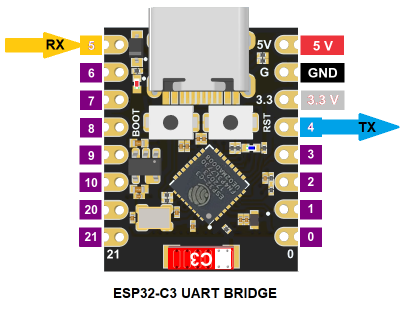

# ESP32-C3 BLE Serial Bridge

This a ESP32-C3 port of `riozebratubo/esp32_serial_ble_bridge`.

  

It provides two independent paths:

- **BLE <-> UART1 bridge**: iPhone/iPad BLE terminal to a 3.3 V TTL target on GPIO4/GPIO5.
- **Native USB configuration console**: the ESP32-C3 USB Serial/JTAG COM port is used for logs and runtime configuration commands (`list`, `set`, `save`, `restore`, `restart`).

The final build has been compiled, flashed, loopback-tested, and the USB configuration + persistent `save`/`restore` path has been verified.

---

## 1. Tested Hardware and Software

| Item | Known-good setup |
|---|---|
| MCU/board | ESP32-C3 development board |
| IDE | VS Code |
| Extension | Espressif ESP-IDF extension v2.3.0|
| ESP-IDF | **v5.3.6** |
| Target | `esp32c3` |
| Toolchain | ESP32-C3 **RISC-V** toolchain installed by ESP-IDF |
| iOS terminal | BLE Serial Pro `https://github.com/ednieuw` `ednieuw@xs4all.nl` |
| Upstream project | `https://github.com/riozebratubo/esp32_serial_ble_bridge` |
| Upstream license | CC BY-NC 4.0 |

ESP-IDF v5.3.6 is the tested baseline for this fork. The upstream project was written for older/classic ESP32 assumptions, so changing IDF major versions may require additional work.

---

## 2. Final Architecture

```text
                         ESP32-C3
                  +-------------------+
USB connector --->| USB Serial/JTAG   |<--- PC terminal / ESP-IDF Monitor
                  |   logs + commands |
                  |                   |
iPhone BLE <----->| BLE UART bridge   |
                  |        |          |
                  |      UART1        |
                  +--------+----------+
                           |
                      GPIO4 / GPIO5
                           |
                     3.3 V TTL target
```

Important: the **configuration console is not the BLE data channel**. Commands are entered through the C3 native USB Serial/JTAG COM port.

---

## 3. ESP32-C3 Changes from the Upstream Project

### 3.1 UART bridge pins

The upstream defaults GPIO17/GPIO18 are not appropriate for the C3 build. The tested defaults are:

```c
app_settings_t app_settings = {
    .complete_service_uuid = "0000FFE0-0000-1000-8000-00805F9B34FB",
    .complete_characteristic_uuid = "0000FFE1-0000-1000-8000-00805F9B34FB",
    .device_name = "ESPSERIALBLE",
    .manufacturer_bytes = {0x12, 0x23, 0x45, 0x56},
    .desired_ble_mtu = 400,
    .force_mac_address = "",
    .uart_pin_tx = 4,
    .uart_pin_rx = 5,
    .uart_buffer_size = 2048,
    .uart_baud_rate = 115200
};
```

UART1 is used for the actual bridge:

- GPIO4 = TX
- GPIO5 = RX
- Default = 115200, 8N1

### 3.2 BLE 4.2 compatibility

The original code uses the legacy BLE advertising APIs. On ESP32-C3 / ESP-IDF 5.3.6 the BLE 4.2 compatibility feature must be enabled:

```text
CONFIG_BT_ENABLED=y
CONFIG_BT_BLE_42_FEATURES_SUPPORTED=y
CONFIG_BTDM_CTRL_MODE_BLE_ONLY=y
```

The important setting is `CONFIG_BT_BLE_42_FEATURES_SUPPORTED=y`; without it the original GAP advertising calls do not link correctly on this C3 build.

### 3.3 Native USB configuration console

This was the main C3 portability issue.

The original project expected its command parser to receive characters from **UART0**, which works naturally on many classic ESP32 boards with an external USB-to-UART bridge. The ESP32-C3 board used here exposes the PC COM port through the chip's native **USB Serial/JTAG** peripheral instead.

The fixed C3 build therefore:

- configures USB Serial/JTAG as the **primary console**;
- reads configuration commands from `stdin`;
- leaves UART1 exclusively for GPIO4/GPIO5 bridge traffic;
- accepts **CR, LF, or CRLF** line endings.

Relevant defaults:

```text
CONFIG_ESP_CONSOLE_USB_SERIAL_JTAG=y
CONFIG_ESP_CONSOLE_UART_DEFAULT=n
CONFIG_ESP_CONSOLE_SECONDARY_NONE=y
CONFIG_ESP_CONSOLE_SECONDARY_USB_SERIAL_JTAG=n
```

This allows the same USB COM port to show ESP-IDF logs and accept commands such as `list`.

### 3.4 Persistent settings / SPIFFS

The project already contained a suitable SPIFFS partition, but the original active configuration did not select the custom partition table.

The working build uses:

```text
CONFIG_PARTITION_TABLE_CUSTOM=y
CONFIG_PARTITION_TABLE_CUSTOM_FILENAME="partitions.csv"
```

with:

```text
# Name,   Type, SubType, Offset,  Size, Flags
nvs,      data, nvs,     0x9000,  0x6000,
phy_init, data, phy,     0xf000,  0x1000,
factory,  app,  factory, 0x10000, 1M,
storage,  data, spiffs,  ,        128K,
```

`save` and `restore` now work persistently across reboot.

### 3.5 Flash size

The tested board has 4 MB flash:

```text
CONFIG_ESPTOOLPY_FLASHSIZE_4MB=y
CONFIG_ESPTOOLPY_FLASHSIZE="4MB"
```

This also removes the earlier 4 MB detected / 2 MB configured warning.

---

## 4. Build and Flash

In the ESP-IDF VS Code extension:

1. Open the project folder.
2. Select **ESP-IDF v5.3.6**.
3. Set target to **esp32c3**.
4. Select the ESP32-C3 USB COM port for flash/monitor.
5. Do a **Full Clean** after changing target or important `sdkconfig` options.
6. Build.
7. Flash.
8. Start the monitor.

There is no need to use OpenOCD/JTAG debugging for normal build, flash, USB configuration, or BLE-UART operation.

---

## 5. USB Configuration Commands

Commands are entered on the **native USB Serial/JTAG COM port** used by the ESP-IDF monitor/log console.

The patched parser accepts CR, LF, and CRLF, so a normal terminal Enter key can be used. For an explicit send-string function, `list\r` is also valid.

### List current settings

```text
list
```

Verified output resembles:

```text
SERIALBLE_SETTINGS: Current settings:
SERIALBLE_SETTINGS: - complete_service_uuid: 0000FFE0-0000-1000-8000-00805F9B34FB
SERIALBLE_SETTINGS: - complete_characteristic_uuid: 0000FFE1-0000-1000-8000-00805F9B34FB
SERIALBLE_SETTINGS: - device_name: ESPSERIALBLE
SERIALBLE_SETTINGS: - desired_ble_mtu: 400
SERIALBLE_SETTINGS: - force_mac_address:
SERIALBLE_SETTINGS: - uart_pin_tx: 4
SERIALBLE_SETTINGS: - uart_pin_rx: 5
SERIALBLE_SETTINGS: - uart_buffer_size: 2048
SERIALBLE_SETTINGS: - uart_baud_rate: 115200
```

### Change a setting

Syntax:

```text
set setting_name="value"
```

Examples:

```text
set uart_baud_rate="9600"
set uart_pin_tx="4"
set uart_pin_rx="5"
set uart_buffer_size="2048"
set device_name="ESPSERIALBLE"
set desired_ble_mtu="400"
```

Other supported settings in the original command parser are:

```text
complete_service_uuid
complete_characteristic_uuid
force_mac_address
```

`list` immediately shows the modified in-RAM value.

**Important:** `set` alone does not reinitialize an already-running UART/BLE peripheral. Use `save` to store the settings and reboot; the new hardware configuration is applied during startup.

### Save and apply

```text
save
```

This writes the current settings to SPIFFS and restarts the ESP32-C3.

Verified sequence:

```text
set uart_baud_rate="9600"
list
save
```

After reboot:

```text
list
```

still reports 9600, confirming persistent storage. Set it back to the required target baud and `save` again when finished testing.

### Restore compiled defaults

```text
restore
```

This removes the saved settings and restarts using the compiled defaults.

### Restart without changing settings

```text
restart
```

---

## 6. BLE Connection from iPhone/iPad

1. Open BLE Serial Pro.
2. Scan for **`ESPSERIALBLE`**.
3. Connect.
4. Use service `FFE0` / characteristic `FFE1`.
5. Enable notifications/listening on characteristic `FFE1`.

A successful connection normally produces log messages including GATT connect, MTU negotiation, characteristic access, and `notify enable`.

The configured desired MTU is 400.

---

## 7. Loopback Test

Before connecting a target:

1. Short **GPIO4 to GPIO5**.
2. Connect from BLE Serial Pro.
3. Send `hello`.
4. `hello` should echo back to the phone.

Typical monitor activity:

```text
SERIALBLE_BLE: Received (len 5): hello
SERIALBLE_UART: Sending data to BLE: [mtu: 400, read size: 5, data: hello]
```

This verifies the complete path:

```text
iPhone -> BLE -> ESP32-C3 -> UART1 TX -> loopback -> UART1 RX -> BLE notify -> iPhone
```

---

## 8. Wiring to the Target

Remove the GPIO4/GPIO5 loopback jumper and connect:

| ESP32-C3 | Target |
|---|---|
| GPIO4 / TX | RX |
| GPIO5 / RX | TX |
| GND | GND |

Rules:

- TX and RX are crossed.
- Common ground is required.
- ESP32-C3 GPIO is **3.3 V logic**. Do not apply 5 V directly to GPIO5; use suitable level translation if the target uses 5 V logic.

---

## 9. Known-Good Final Status

| Function | Status |
|---|---|
| ESP-IDF v5.3.6 build | Verified |
| ESP32-C3 target | Verified |
| Build / flash over USB | Verified |
| Native USB log console | Verified |
| USB `list` command | Verified |
| USB `set` command | Verified |
| CR / LF / CRLF command termination | Implemented |
| SPIFFS settings partition | Working |
| `save` + reboot persistence | Verified |
| `restore` | Working |
| BLE advertising as `ESPSERIALBLE` | Verified |
| FFE0 / FFE1 service/characteristic | Verified |
| BLE MTU 400 | Verified |
| iPhone -> ESP32 BLE receive | Verified |
| UART1 TX on GPIO4 | Verified |
| UART1 RX on GPIO5 | Verified |
| ESP32 -> iPhone BLE notify | Verified |
| GPIO4/GPIO5 loopback | Verified |

---

## 10. Key Files in This Fork

```text
main/esp32_serial_ble_bridge.c   compiled default settings / GPIO4-GPIO5
main/uart.c                      UART1 bridge + native USB command input
main/commands.c                  list/set/save/restore/restart parser
main/settings.c                  SPIFFS settings load/save
sdkconfig.defaults               C3 BLE/USB/partition/flash defaults
partitions.csv                   includes 128 KB "storage" SPIFFS partition
C3_USB_CONFIG_PATCH.md           summary of the C3 USB-console patch
```

For reproducible builds, keep the important C3 options in `sdkconfig.defaults`; the generated `sdkconfig` reflects the currently configured build.

---

## 11. Reference

- Upstream firmware: `https://github.com/riozebratubo/esp32_serial_ble_bridge`
- ESP-IDF VS Code extension: `https://github.com/espressif/vscode-esp-idf-extension`

---

## Summary

The ESP32-C3 now works as a practical wireless UART adapter:

```text
iPhone BLE terminal <-> ESP32-C3 <-> GPIO4/GPIO5 UART <-> target
```

while the C3 native USB connection remains available independently for firmware logs and persistent bridge configuration.
